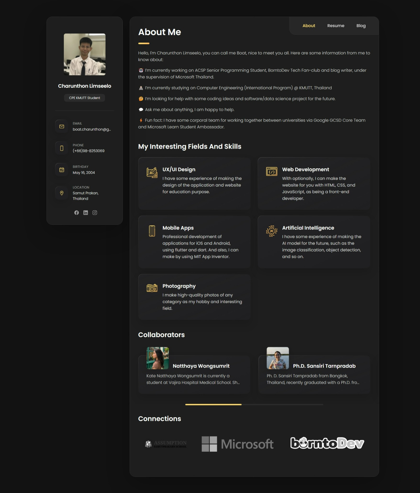

# Charunthon Limseelo - Personal Academic Website

A modern, responsive personal website showcasing academic achievements, research publications, talks, teaching experience, and technical projects. Built with vanilla HTML, CSS, and JavaScript for optimal performance and Vercel compatibility.

## 🚀 Features

- **Responsive Design**: Optimized for desktop, tablet, and mobile devices
- **Academic Focus**: Structured sections for publications, talks, teaching, and research
- **Modern UI**: Clean, professional design with smooth animations
- **Fast Loading**: Vanilla JavaScript for optimal performance
- **Vercel Ready**: No Jekyll dependency for seamless deployment

## 📁 Project Structure

```
personal-site/
├── index.html              # Main homepage with all sections
├── assets/
│   ├── css/
│   │   └── style.css       # Main stylesheet with responsive design
│   ├── js/
│   │   └── script.js       # Interactive functionality
│   └── images/             # Profile images and icons
├── pages/                  # Detailed individual pages
│   ├── publications.html   # Complete publications list
│   ├── talks.html         # Speaking engagements and presentations
│   └── teaching.html      # Teaching experience and philosophy
├── blog/                   # Blog posts and articles
│   └── mlops-episode-2.html # Sample technical blog post
└── README.md              # This file
```

## 🎯 Sections Overview

### 1. About Me
- Personal introduction and background
- Current role as Microsoft Learn Student Ambassador
- Research interests and expertise areas
- Professional collaborators and connections

### 2. Publications
- Research papers and journal articles
- Conference proceedings
- Technical reports and preprints
- Works in progress

### 3. Talks & Presentations
- International conference talks
- Technology conference presentations
- Academic presentations
- Community workshops and training

### 4. Teaching
- University teaching assistant experience
- Workshop series and bootcamps
- Student mentoring and research supervision
- Teaching philosophy and approach

### 5. Portfolio
- Technical projects and applications
- Open-source contributions
- Research implementations
- Innovation showcases

### 6. Blog
- Technical articles and tutorials
- Research insights and findings
- Industry trends and analysis
- Personal experiences and learnings

### 7. CV/Resume
- Complete academic and professional history
- Skills and competencies
- Awards and recognition
- Downloadable PDF resume

## 🛠️ Technical Implementation

### Technologies Used
- **HTML5**: Semantic markup for accessibility and SEO
- **CSS3**: Modern styling with Flexbox and Grid layouts
- **Vanilla JavaScript**: Interactive navigation and dynamic content
- **Ionicons**: Consistent iconography throughout the site
- **Google Fonts**: Chakra Petch font family for modern typography

### Key Features
- **Single Page Application**: Smooth navigation between sections
- **Mobile-First Design**: Responsive layouts for all devices
- **Performance Optimized**: Minimal dependencies and fast loading
- **Accessibility**: Semantic HTML and proper ARIA labels
- **SEO Friendly**: Structured data and meta tags

## 🎨 Design Philosophy

The website follows modern web design principles:

- **Minimalist Aesthetic**: Clean layouts with plenty of white space
- **Consistent Branding**: Cohesive color scheme and typography
- **User-Centered Design**: Intuitive navigation and clear information hierarchy
- **Academic Professional**: Appropriate for academic and professional contexts

## 📱 Responsive Breakpoints

- **Mobile**: 320px - 767px
- **Tablet**: 768px - 1023px
- **Desktop**: 1024px and above

## 🚀 Deployment

### Vercel Deployment
This site is optimized for Vercel deployment:

1. Connect your GitHub repository to Vercel
2. No build configuration needed (static HTML)
3. Automatic deployments on push to main branch

### Alternative Hosting
The site can be hosted on any static hosting service:
- GitHub Pages
- Netlify
- Azure Static Web Apps
- Firebase Hosting

## 🔧 Customization

### Adding New Content

#### Publications
1. Edit `index.html` - add summary in the Publications section
2. Edit `pages/publications.html` - add full details
3. Include proper metadata and links

#### Blog Posts
1. Create new HTML file in `blog/` directory
2. Use the template from `blog/mlops-episode-2.html`
3. Update the blog section in `index.html`

#### Talks
1. Add summary to `index.html` Talks section
2. Add full details to `pages/talks.html`
3. Include slides, videos, and related materials

### Styling Customization
- Edit `assets/css/style.css` for visual changes
- Color scheme defined in CSS custom properties
- Responsive design utilities available

### JavaScript Functionality
- Navigation logic in `assets/js/script.js`
- Modal and interactive components
- Form handling and validation

## 📞 Contact

**Charunthon Limseelo**
- Email: boat.charunthon@gmail.com
- LinkedIn: [linkedin.com/in/boatchrnthn](https://www.linkedin.com/in/boatchrnthn/)
- GitHub: [github.com/chrnthnkmutt](https://github.com/chrnthnkmutt)
- Website: [chrnthnkmutt.github.io](https://chrnthnkmutt.github.io)

## 📄 License

[MIT](https://choosealicense.com/licenses/mit/)

## Demo Image


---

*Built with ❤️ for the academic and research community*
